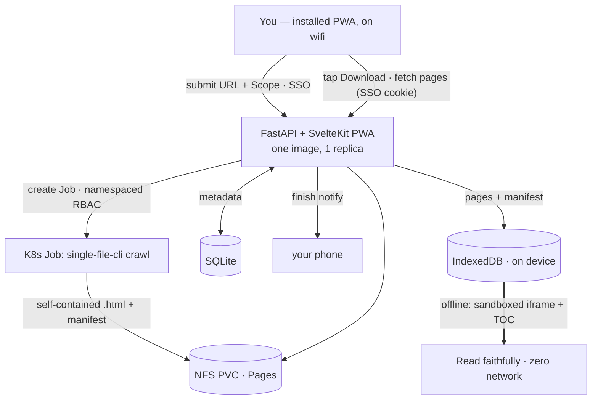
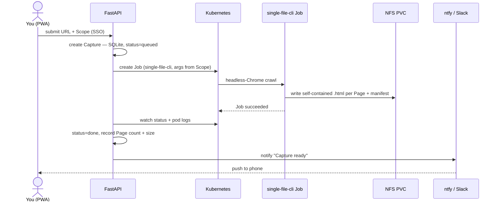

# Offline Reader — design

**Status:** approved · **Date:** 2026-07-27 · **Owner:** Viktor Barzin

Read whole websites offline — on a plane, with zero network. You feed a URL to an endpoint;
the server crawls and **faithfully** preserves the site as self-contained pages; an
**installable PWA** downloads chosen Captures onto your phone and reads them offline, with
**no manual file handling**.

> [!IMPORTANT]
> **This design reversed once, deliberately.** The first cut adopted **Kiwix + zimit** to
> avoid building anything ([ADR-0001](adr/0001-adopt-kiwix-zimit.md)). But the requirement
> "the app stores captures natively, I don't touch files" cannot be met by the Kiwix client
> on iOS. So we **build a custom PWA** ([ADR-0005](adr/0005-build-custom-pwa-single-file.md))
> that captures with **single-file-cli**, stores pages in **IndexedDB**, and reads them in a
> sandboxed iframe. A PWA runs in the browser, so its downloads carry your SSO cookie — the
> seamless in-app flow "just works" where the native app couldn't.

```stats
1 | app we build (FastAPI + SvelteKit PWA)
single-file-cli | capture engine (reused)
IndexedDB | native on-device store
£0 | added cost — self-hosted
```

Vocabulary is defined in [CONTEXT.md](../CONTEXT.md) — **Capture**, **Page**, **Crawl**,
**Scope**, **Library**, **Download**, **Refresh**, **Reader**.

---

## Architecture



The FastAPI backend and the SvelteKit PWA ship as **one image, served same-origin** (the
tripit/tasks pattern). `single-file-cli` is the only external capture dependency.

---

## Flow 1 — Capturing a site



## Flow 2 — Download & read offline

```mermaid
sequenceDiagram
  actor V as You
  participant P as PWA (installed)
  participant UI as FastAPI
  participant IDB as IndexedDB

  Note over V,IDB: Before the flight — on wifi
  V->>P: open PWA (SSO)
  V->>P: tap "Download" on a Capture
  P->>UI: fetch manifest + all Page blobs (SSO cookie)
  UI-->>P: pages
  P->>IDB: store pages + manifest; call persist()
  Note over V,IDB: On the plane — network OFF
  V->>P: open the Capture
  P->>IDB: load a Page
  P-->>V: render in sandboxed iframe + TOC · 100% offline
```

Downloads run in the **foreground** (iOS has no Background Fetch) and are chunked +
resumable. The app shell is precached (injectManifest SW), so the PWA itself opens offline.

---

## Decisions

| # | Decision | Rationale / ADR |
|---|----------|-----------------|
| 1 | **Faithful** snapshot (not reader-mode) | Pages keep their real styles/images/layout |
| 2 | **Build a custom PWA**; capture with single-file-cli | Seamless native offline storage, which Kiwix can't do on iOS. Supersedes the adopt-Kiwix plan. [ADR-0005](adr/0005-build-custom-pwa-single-file.md) · ([ADR-0001](adr/0001-adopt-kiwix-zimit.md) superseded) |
| 3 | A **Capture** = one root URL → many self-contained **Pages** + a manifest | [CONTEXT.md](../CONTEXT.md) |
| 4 | **Scope**: default `prefix`; page/prefix/host/domain; caps 1000 pages · 2 GB soft · 45 min; autoscroll; advanced include/exclude | Replaces per-page selection |
| 5 | **Build shape**: FastAPI + SvelteKit PWA, one image, same-origin | tripit/tasks pattern; reading is in-app |
| 6 | **Execution**: one K8s Job per Capture (single-file-cli); namespaced Job RBAC; limits + deadline + TTL | [ADR-0002](adr/0002-one-k8s-job-per-capture.md) |
| 7 | **Exposure**: public, fully SSO; PWA downloads in-app (same-origin cookie carried) | [ADR-0003](adr/0003-exposure-and-download-path.md) |
| 8 | **Reader**: self-contained HTML in IndexedDB, sandboxed iframe, manifest TOC + link rewriting; scripts stripped | [ADR-0006](adr/0006-offline-reader-model.md) |
| 9 | **Lifecycle**: Refresh re-crawls & replaces (keep latest); manual delete; no auto-prune; UI shows disk used | Current-version-on-the-plane |
| 10 | **Metadata**: SQLite on the PVC, not shared Postgres | [ADR-0004](adr/0004-sqlite-metadata-on-pvc.md) |
| 11 | **v1 extras**: finish-notification IN; scheduled re-capture / login-walled / EPUB / client-side search **deferred** | Keep v1 lean |
| 12 | First-party app → **semver from v0.1.0**; own infra stack (Terraform → GHCR → Woodpecker + Keel) | Homelab convention |

---

## Components

### FastAPI + SvelteKit PWA (the build) — one same-origin image
- **Backend (FastAPI):** submit URL + Scope; create/watch single-file-cli **Jobs** via the
  Kubernetes API (namespaced ServiceAccount); serve the captured Pages + manifest as
  authenticated responses; persist Capture metadata to **SQLite**; POST a **finish
  notification** (ntfy for phone push, or the house Slack webhook) on Job success.
  `/healthz`, `/metrics`.
- **Frontend (SvelteKit adapter-static PWA, Svelte 5 + `idb`):** the Library (list Captures
  + live status); **Download** (fetch manifest + Page blobs → IndexedDB, with progress +
  `persist()`); the **Reader** (sandboxed `<iframe srcdoc>` + a TOC from the manifest +
  inter-page link rewriting); storage usage + evicted-Capture re-download. App shell
  precached via an injectManifest service worker (tripit/tasks pattern) for offline open.

### single-file-cli Job (upstream)
- Args from Scope: crawl the root within the path prefix (`--crawl-links`,
  `--crawl-max-depth`, inner-links-only), `--browser-wait-until networkidle0`,
  `--load-deferred-images` (lazy images), scripts removed (default). Emits one
  self-contained HTML per Page + a manifest.
- Pod spec: resource limits, `activeDeadlineSeconds` (~45 min), `ttlSecondsAfterFinished`,
  `/dev/shm` `emptyDir { medium: Memory }` for Chrome. Writes to the shared RWX PVC.

### Storage
- One `nfs-truenas` **RWX** PVC on **HDD** (`/srv/nfs/offline-reader`), mounted by the app
  and every Job. Holds captured Pages + manifests + the SQLite file. The device copy lives
  in **IndexedDB**.

---

## Reader model (ADR-0006)

- **Self-contained HTML, scripts stripped** → renders in a `sandbox` iframe **without**
  `allow-scripts`: safe (no untrusted JS on our origin) and simple (no decoder/replay).
- **Navigation** = a TOC built from the Crawl manifest + link rewriting: links to captured
  Pages load from IndexedDB; links to un-captured URLs open online only with signal.
- **iOS storage**: install-to-home-screen + `persist()` (feature-checked) → ~60%-of-disk
  quota and 7-day-wipe exemption, but **no absolute guarantee** → a Capture is always
  re-downloadable, and we prove durability with a real-device test.

---

## Crawl & Scope

| Setting | Default | UI |
|---------|---------|-----|
| scope type | `prefix` | dropdown: page / prefix / host / domain |
| max pages | 1000 | editable |
| max size (soft) | 2 GB | editable |
| time cap | 45 min | fixed (→ Job deadline) |
| lazy images | load-deferred on | fixed |
| include / exclude | — | advanced (collapsible) |

Book/docs → `prefix`; single article → `page`; whole site → `host`. Caps bound each Job in
pages, bytes, and wall-clock.

---

## Deployment (homelab conventions)

New Terragrunt stack `infra/stacks/offline-reader/`, based on `stacks/tasks` (a small
owner-only FastAPI + SvelteKit app served as one image). Two hand-authored files
(`terragrunt.hcl` + `main.tf`); generated files come from the root.

- **Namespace** `offline-reader`; labels `tier = 4-aux`, `istio-injection = disabled`,
  `keel.sh/enrolled = "true"`.
- **Deployment** replicas = 1, `strategy { type = "Recreate" }`, `registry-credentials`
  pull secret (public GHCR image → nothing extra), `/healthz` probes, resource limits,
  `lifecycle.ignore_changes` on image + keel annotations.
- **Ingress** via `modules/kubernetes/ingress_factory`, `auth = "required"`,
  `allowed_groups = ["Home Server Admins"]` (owner-only Authentik). `dns_type = "proxied"`.
- **TLS**: `tls_secret_name = var.tls_secret_name`; Kyverno `sync-tls-secret` clones the
  wildcard cert — no cert-manager.
- **Storage**: `module "nfs_volume"` (`nfs-truenas`, RWX, `/srv/nfs/offline-reader`).
- **Job RBAC**: namespaced SA + Role + RoleBinding (shape of `stacks/android-emulator/
  gate.tf`; rules = `batch/jobs` CRUD + `pods`,`pods/log` read); pod sets
  `service_account_name`.
- **NetworkPolicy**: replicate the `tasks` ingress policy (allow only `traefik` +
  `monitoring`), so nothing bypasses Authentik via the pod IP. Egress open → crawl works.
- **Secrets** (ntfy token / Slack webhook, if used): `ExternalSecret` against
  ClusterSecretStore `vault-kv`. No DB creds (SQLite).
- **CI**: scaffold with `infra/scripts/offinfra-onboard` → `.github/workflows/build.yml`
  (lint/test → GHCR `ghcr.io/viktorbarzin/offline-reader`) + `.woodpecker/deploy.yml`.
  Forgejo `viktor/offline-reader` mirrored to GitHub; semver via `svu`.

---

## v1 scope

**In:** submit + Scope → single-file-cli Job → Pages on NFS → SSO'd Library → **in-app
Download to IndexedDB** → offline Reader (sandboxed iframe + TOC) → finish-notification.

**Deferred (not dropped):** client-side full-text search, scheduled re-capture (CronJob),
login-walled capture, EPUB export.

---

## Milestones

- **v0.1.0** — FastAPI: submit URL → single-file-cli Job → Pages + manifest on disk; list
  Captures; serve Pages. Local run per the tasks/tripit recipe.
- **v0.2.0** — PWA: Library + Download to IndexedDB (progress + `persist()`); Reader
  (sandboxed iframe + manifest TOC + link rewriting); app-shell offline.
- **v0.3.0** — Scope UI + caps + advanced regex; Refresh (replace); delete; storage usage +
  evicted-Capture handling; finish-notification; `/metrics`.
- **v0.4.0** — infra stack + CI; deploy behind SSO; **on-device test**: capture a real docs
  site, download in the installed PWA, read in airplane mode; verify `persist()` holds.
- **v1.0.0** — verified stable end-to-end on the phone.

---

## Known sharp edges (accepted)

> [!CAUTION]
> **iOS storage is protected, not guaranteed.** Install + `persist()` exempt the origin from
> the 7-day wipe and grant a large quota, but Apple can still evict under disk pressure —
> and eviction is whole-origin, all-or-nothing. The UX treats every Capture as
> re-downloadable; we verify durability on a real device before trusting a flight.

- **single-file-cli is weak on heavy-JS / SPA sites, infinite scroll, and video** — great
  for books / docs / articles, poor for app-like pages. Scripts are stripped by design.
- **Whole-site navigation + search are ours to build** (manifest TOC + link rewriting;
  search deferred) — they were free with ZIM, and are the price of the seamless PWA.
- **No background download on iOS** — keep the app open while a Capture downloads (chunked,
  resumable).

## References

- ADRs: [0001](adr/0001-adopt-kiwix-zimit.md) *(superseded)* ·
  [0002](adr/0002-one-k8s-job-per-capture.md) · [0003](adr/0003-exposure-and-download-path.md)
  · [0004](adr/0004-sqlite-metadata-on-pvc.md) ·
  [0005](adr/0005-build-custom-pwa-single-file.md) · [0006](adr/0006-offline-reader-model.md)
- Upstream: single-file-cli (`gildas-lormeau/single-file-cli`); the SvelteKit + FastAPI +
  `idb` PWA pattern from `tripit` / `tasks`.
